# Домашнее задание к занятию "Что такое DevOps. СI/СD" - Качьянов Вадим

### Задание 1

Сделан Freestyle Job, который запускает тесты, собирает docker-образ и пушит его в Nexus.

1) Jenkins
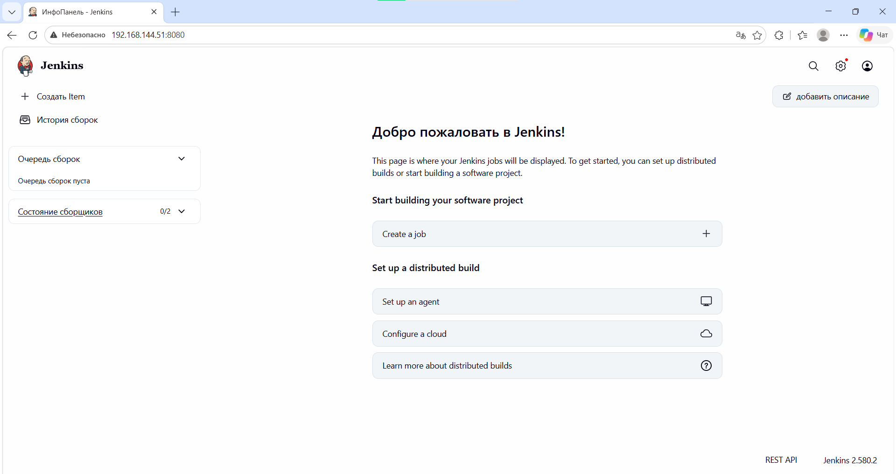
2) Настройки проекта
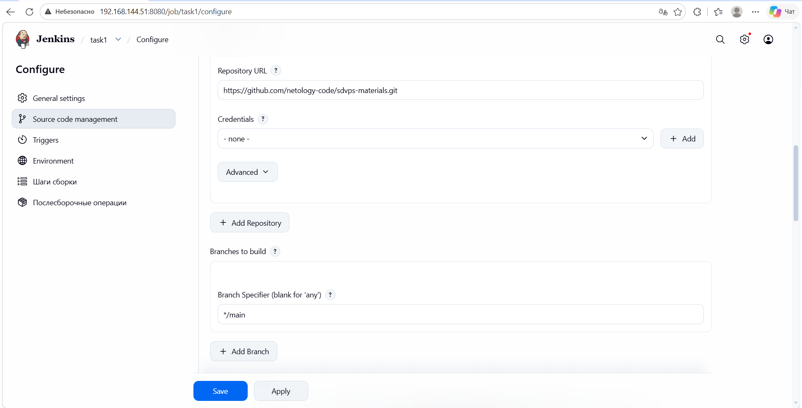
3) Результат сборки
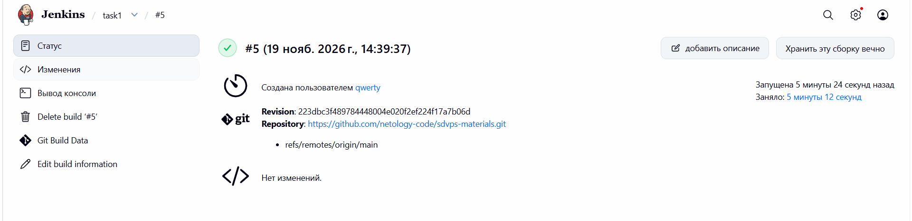

### Задание 2

Freestyle Job переделан в Declarative Pipeline.

1) Pipeline
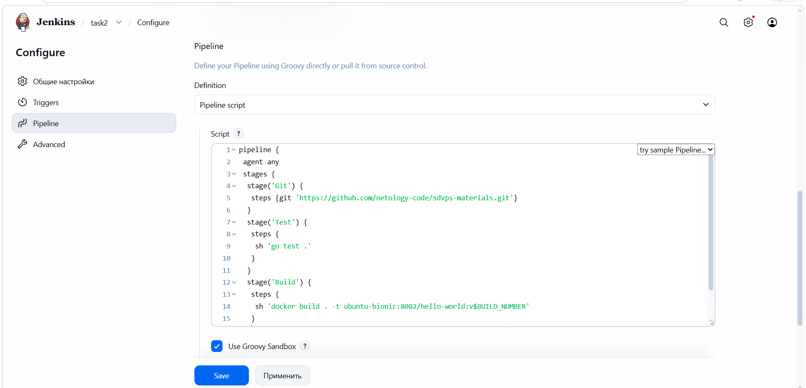
2) Результат сборки
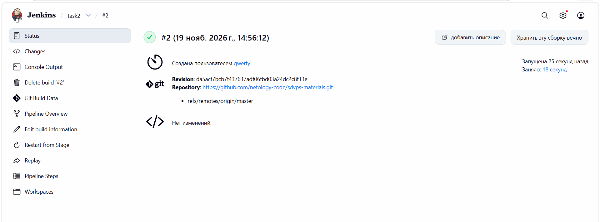

### Задание 3

В Nexus создан raw-hosted репозиторий. Pipeline собирает бинарник go и загружает его в Nexus.

1) Nexus
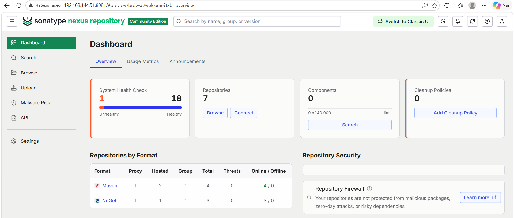
2) Создание репозитория
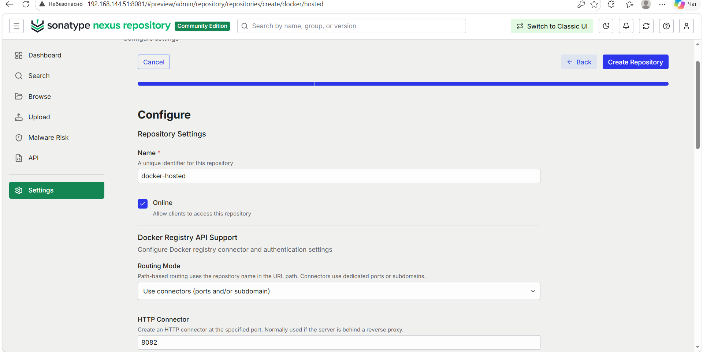
3) Pipeline
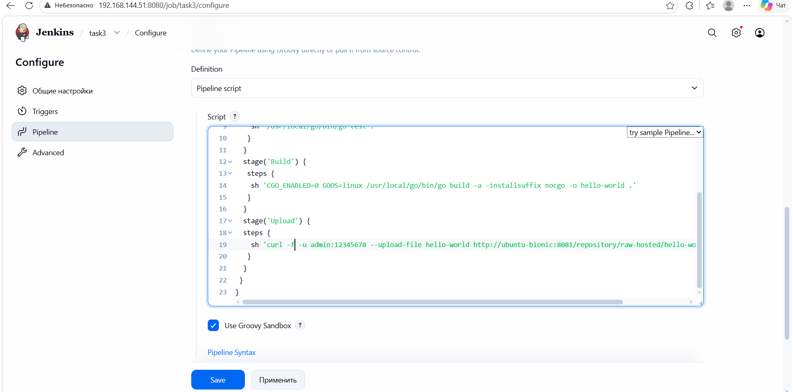
4) Результат сборки
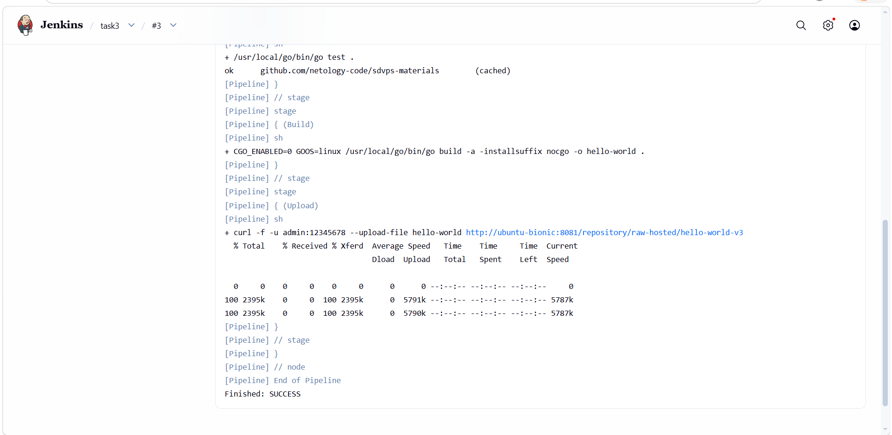
5) Бинарник в Nexus
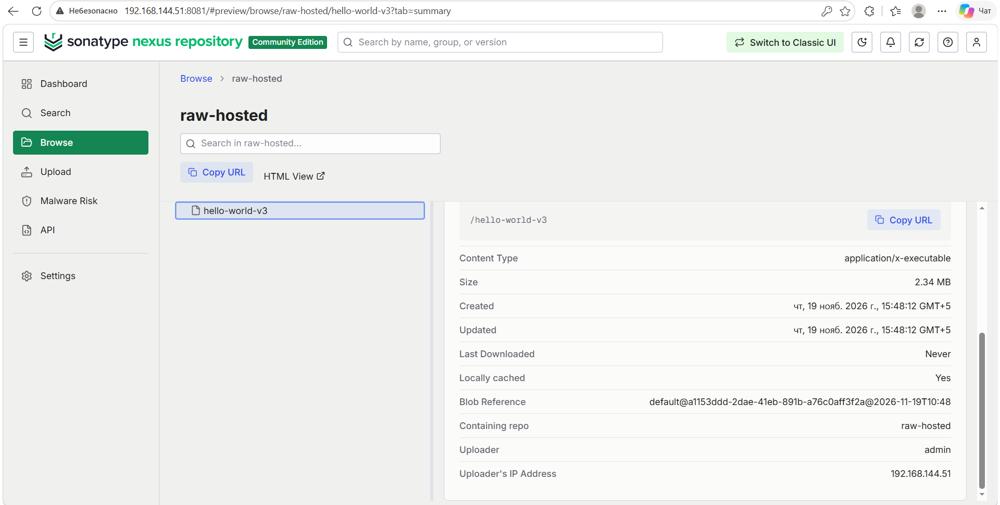

### Задание 4*

Версия задаётся через переменную VERSION = 1.0.$BUILD_NUMBER, каждая сборка загружается в Nexus в свою папку.

1) Pipeline
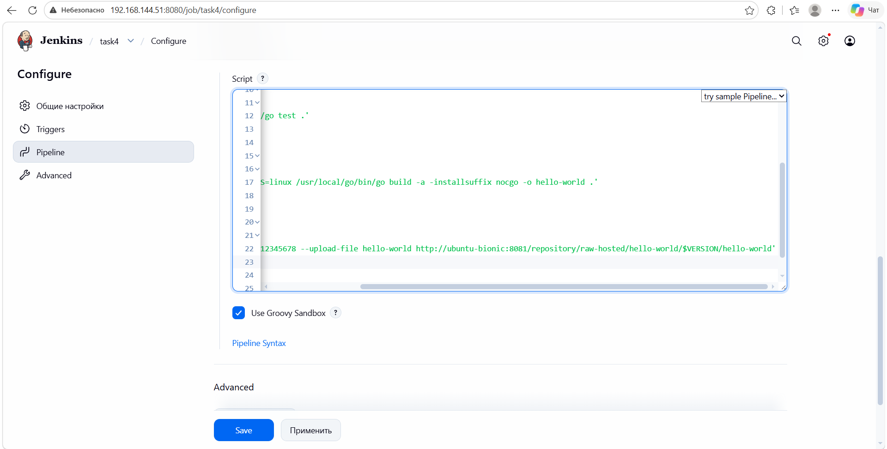
2) Версия в Nexus
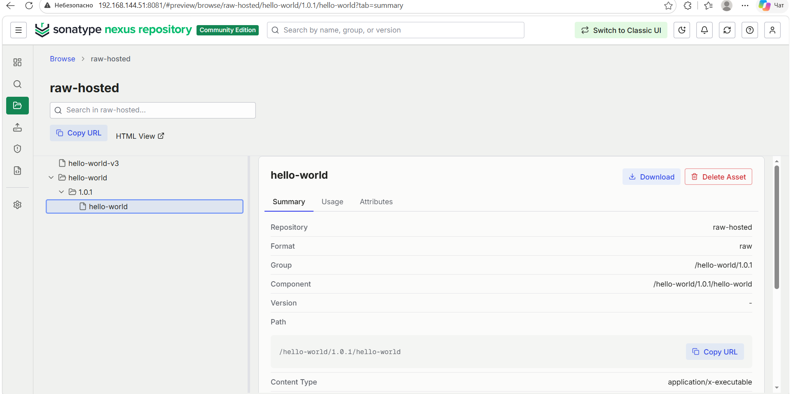
